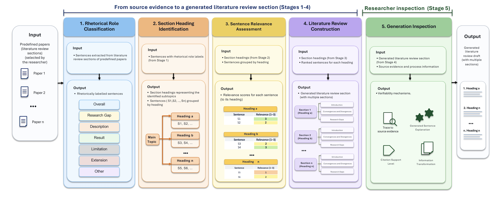
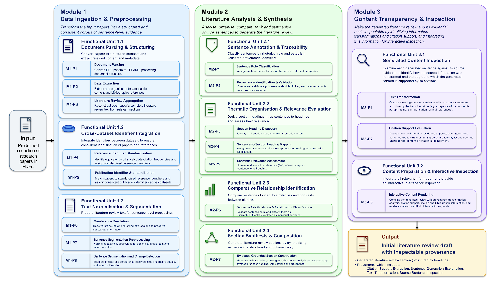
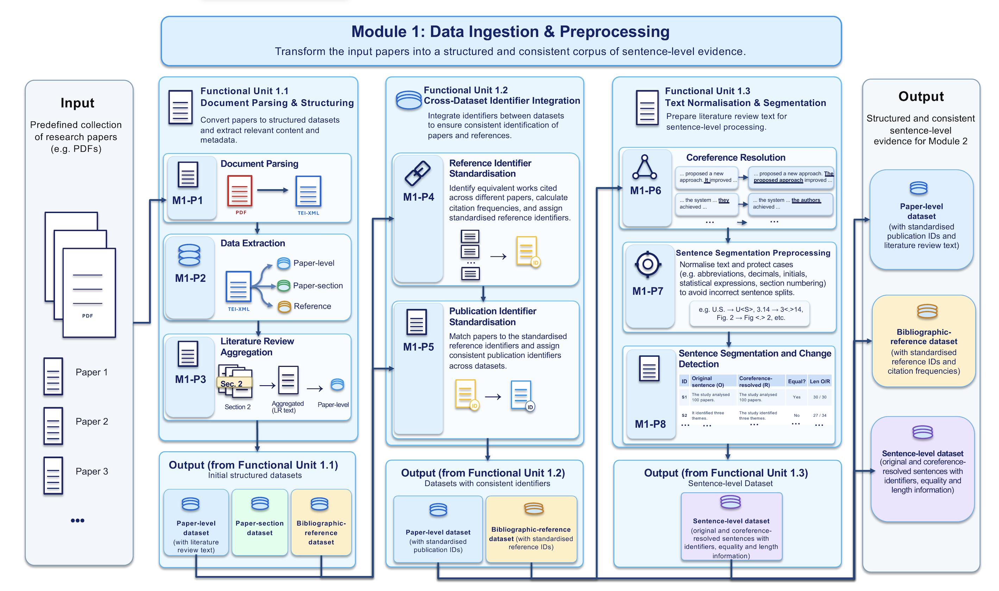
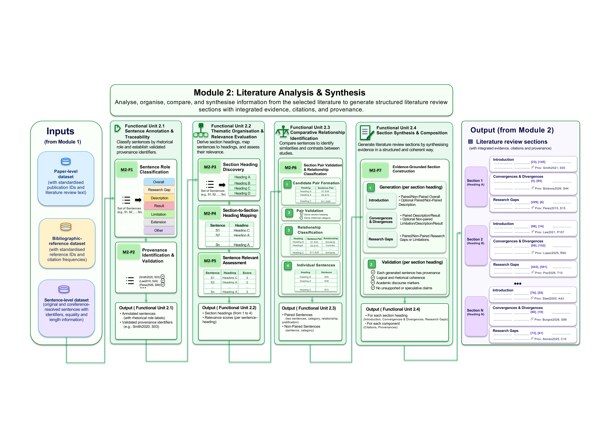
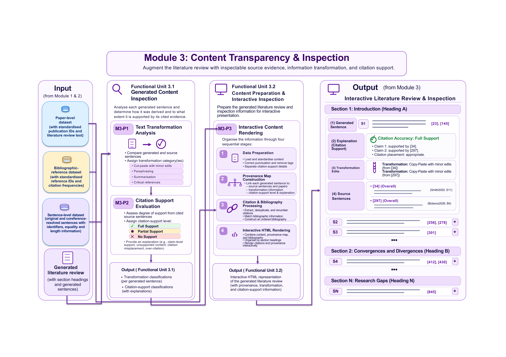

# LitTraceAI

This repository implements LitTraceAI (Literature Traceability using Artificial Intelligence), a prototype tool based on retrieval-augmented generation (RAG). It drafts literature review sections based on the papers researchers selected to conduct the literature review. LitTraceAI supports **researcher agency** through sentence-level inspection of source evidence, its rhetorical roles and transformations, and citation support.

## 📖 Overview

LitTraceAI combines AI-Assisted Literature Review (AILR) principales, the rhetorical structure of scientific writing, and trustworthiness principles to guide evidence organisation, synthesis, and researcher inspection.
- **AILR principles.** Supports Literature Review Planning and Critical Synthesis and Knowledge Organisation, with researcher agency guiding draft inspection. [Explore the AILR framework](https://github.com/fcobolanos/RWG_Survey/tree/main).
- **Rhetorical structure.** Uses a fine-tuned Gemma 2 9B classifier to identify the roles of sentences in source literature review sections, including study descriptions, results, limitations, and research gaps. [Explore the classifier](https://github.com/fcobolanos/Classifying-the-Components-of-a-Literature-Review).
- **Thematic organisation.** Groups evidence under topic headings, following a concept-centric approach (Webster and Watson, 2002), and ranks sentences by relevance.
- **Synthesis across studies.** Drafts sections with a topic overview, analysis of convergences and divergences, and research gap synthesis.
- **Trustworthiness and inspection.** Prioritises robustness, transparency, and accountability through relevance ranking, sentence-level provenance, transformation labels, and citation-support assessments, helping researchers decide what to retain, revise, or reject.

## 🎯 Intended Use and Researcher Responsibility

LitTraceAI starts with a collection of relevant papers selected by the researcher and produces an **initial draft** for evaluation, revision, and refinement before incorporation into the final manuscript. Researchers remain responsible for validating citations, checking factual accuracy and potential plagiarism, and assessing whether the synthesis faithfully represents the findings and contributions of the cited studies.

## 🔍 Trustworthiness Design Principles

LitTraceAI uses RAG to combine evidence from selected research papers with language model generation. Trustworthiness in RAG encompasses accuracy, reliability, fairness, transparency, accountability, and user privacy when integrating external knowledge into generated outputs (Ni et al., 2025). The framework guiding LitTraceAI identifies six dimensions: factuality, robustness, fairness, transparency, accountability, and privacy (Zhou et al., 2024b).

LitTraceAI prioritises three of these dimensions through features that help researchers inspect and evaluate a generated review:

- **Robustness through evidence ranking.** Source sentences are assessed and ranked by their relevance to each section heading. This prioritises evidence suited to the topic and reduces the influence of noisy or weakly relevant information on the synthesis.
- **Transparency through sentence-level inspection.** Researchers can see which source sentences contributed to each generated sentence, their rhetorical roles, and how their information was transformed during synthesis. Transformation labels include reuse with minor edits, paraphrasing, summarisation, and critical references. The implementation code is also available for inspection.
- **Accountability through verifiability.** Verifiability means grounding generated claims in supporting evidence and presenting them so that people can readily check that support (Zhang et al., 2025e). Validated provenance identifiers link generated sentences to exact source sentences. Automated citation-support assessments indicate full, partial, or no support, allowing researchers to review each assessment alongside the cited evidence.

Together, these features support **researcher agency** and informed trust. Researchers can inspect how individual sentences were generated, assess their evidential support, and decide what to revise or retain. Citation-support assessments address whether the cited evidence substantiates a claim. Researchers remain responsible for checking factual accuracy and the suitability of the synthesis for their manuscript.

## 🔄 Literature Review Workflow

The workflow is grounded in **AI-Assisted Literature Review (AILR)**, which conceptualises AI support for the scholarly activities involved in developing a literature review while preserving researcher judgement and accountability. AILR encompasses Literature Discovery and Selection, Literature Review Planning, Critical Synthesis and Knowledge Organisation, and Iterative Development. [Explore the AILR framework](https://github.com/fcobolanos/RWG_Survey/tree/main).

LitTraceAI implements **Literature Review Planning** through thematic headings and section organisation, and **Critical Synthesis and Knowledge Organisation** through rhetorical classification, evidence ranking, and synthesis across studies. Its Generation Inspection stage supports researcher agency within the **AI-in-the-Loop** paradigm, where researchers lead scholarly decisions and AI supplies supporting information and analysis (Natarajan et al., 2025). The pipeline takes researcher-selected papers as input and produces a draft for subsequent researcher evaluation and refinement.

LitTraceAI translates these activities and the researcher agency principle into five processing and inspection stages, shown in the flowchart and outlined below.

1. **Rhetorical role classification** assigns a functional role to each source sentence.
2. **Section heading identification** identifies subtopics (headings) and groups source sentences under headings.
3. **Sentence relevance assessment** scores the evidence for each heading.
4. **Literature review construction** synthesises the evidence into draft sections with citations and provenance links.
5. **Generation inspection** lets researchers inspect the source evidence, see how it was transformed, and review the citation-support assessment.

## 💻 Implementation Architecture

LitTraceAI implements the literature review workflow as a modular processing pipeline. The overall architecture diagram shows three levels of organisation:

- **Modules** define the major phases of the pipeline, each with an overall purpose, input, and output.
- **Functional units** group related operations within each module, such as document parsing, evidence organisation, or generated content inspection.
- **Procedures** carry out the individual processing operations within each functional unit. Each procedure consumes data, performs an operation, and produces an output that can feed another procedure within the same unit, another functional unit, or a subsequent module.

This flow connects paper preparation in Module 1, review generation in Module 2, and interactive inspection in Module 3. 

### Module 1 : Data Ingestion & Preprocessing

- **Input.** A predefined collection of research papers in PDF format, selected by the researcher.
- **Process.** Converts the selected papers into a consistent collection of sentence-level evidence by extracting literature review text and bibliographic information, aligning identifiers across papers and references, and preparing the text for analysis.
- **Output.** An enriched paper-level dataset, a bibliographic-reference dataset with standardised identifiers, and literature review sentences in their original and coreference-resolved forms. These supply Module 2 with structured evidence and its associated paper information.

### Module 2 : Literature Analysis & Synthesis

- **Input.** Source sentences and their associated paper information prepared by Module 1.
- **Process.** Uses the rhetorical roles of source sentences to organise evidence by theme, prioritise relevant material, compare findings across studies, and synthesise structured review sections while preserving links to the sources.
- **Output.** A literature review draft organised by section headings, with citations and provenance identifiers linking each generated sentence to the source sentences used to construct it.

### Module 3 : Content Transparency & Inspection

- **Input.** The literature review draft and provenance identifiers from Module 2, together with the corresponding source sentences, paper metadata, and reference information prepared earlier in the pipeline.
- **Process.** Examines how source evidence was used in each generated sentence and how well the citations support its claims, then brings the draft, evidence, and assessments together for interactive researcher inspection.
- **Output.** A self-contained interactive HTML literature review in which researchers can inspect the source evidence, rhetorical roles, information transformations, and citation-support assessments associated with each generated sentence.

## 💻 Code Information

The LitTraceAI processing pipeline is implemented using customised Python and R scripts, a fine-tuned Gemma 2 9B classifier, and large language models (LLMs). The table maps each procedure to its implementation. [Browse the implementation code](https://github.com/fcobolanos/LitTraceAI_Implementation/tree/main/code).

To see which sources the pipeline used for each generated literature review, consult the selected papers and their corresponding TEI-XML files in the  [raw data directory](https://github.com/fcobolanos/LitTraceAI_Implementation/tree/main/raw%20data).

| Module | Functional unit | Procedure | Implementation |
| --- | --- | --- | --- |
| 1. Data Ingestion & Preprocessing | Document Parsing & Structuring | M1-P1 Document Parsing | Python script |
| | | M1-P2 Data Extraction | Python script |
| | | M1-P3 Literature Review Aggregation | R script |
| | Cross-Dataset Identifier Integration | M1-P4 Reference Identifier Standardisation | R script |
| | | M1-P5 Publication Identifier Standardisation | R script |
| | Text Normalisation & Segmentation | M1-P6 Coreference Resolution | GPT-4o |
| | | M1-P7 Sentence Segmentation Preprocessing | R script |
| | | M1-P8 Sentence Segmentation and Change Detection | R script |
| 2. Literature Analysis & Synthesis | Sentence Annotation & Traceability | M2-P1 Sentence Role Classification | Fine-tuned Gemma 2 9B script |
| | | M2-P2 Provenance Identification & Validation | R script |
| | Thematic Organisation & Relevance Evaluation | M2-P3 Section Heading Discovery | GPT-4o |
| | | M2-P4 Sentence-to-Section Heading Mapping | GPT-4o |
| | | M2-P5 Sentence Relevance Assessment | DeepSeek-R1 |
| | Comparative Relationship Identification | M2-P6 Sentence Pair Validation & Relationship Classification | GPT-4o |
| | Section Synthesis & Composition | M2-P7 Evidence-Grounded Section Construction | GPT-4o |
| 3. Content Transparency & Inspection | Generated Content Inspection | M3-P1 Text Transformation Analysis | GPT-4o |
| | | M3-P2 Citation Support Evaluation | GPT-4o |
| | Content Preparation & Interactive Inspection | M3-P3 Interactive Content Rendering | Python script |

**Sentence Role Classification.** The fine-tuned Gemma 2 9B script classifies each segmented sentence into one of the seven rhetorical categories defined by the annotation schema in Section 3.2.2. [View the Gemma classifier notebook](https://github.com/fcobolanos/Classifying-the-Components-of-a-Literature-Review/blob/main/code/fine-tuning/LRO_ft_Gemma.ipynb).

**Model selection.** GPT-4o implements the procedures that rely on an LLM, with DeepSeek-R1 used for Sentence Relevance Assessment. During development, a preliminary heuristic evaluation for model selection ran the complete LitTraceAI pipeline on ten cases across three disciplines (five in computer science, three in business, and two in psychology). It considered Mistral, Sonnet, OLMo, GPT-4o, and DeepSeek-R1. GPT-4o and DeepSeek-R1 gave the best results for their respective procedures. The expert evaluation reported in subsequent chapters was conducted separately.

**LLM calls.** Each procedure that uses an LLM makes exactly one call to its assigned model per execution.

**Prompt design and temperature.** The prompt template for each LLM-based procedure was refined iteratively following Berryman and Ziegler (2024). The temperature was set to `0` for consistency. During the preliminary evaluation, values above `0` changed the scientific terminology in generated content, altering its intended meaning and reducing the quality of the affected procedures.

## 🚀 Explore the Interactive Examples

The interface catalogue lists **26 LitTraceAI-generated literature reviews across 12 research fields**. Choose a review to explore the generated sections, the source sentences behind individual claims, and the citation-support assessments.

[Open the LitTraceAI Interface](https://fcobolanos.github.io/LitTraceAI_Interface/)
